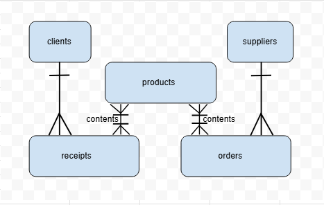

# Design Document

By Kozlov Dmytro

## Scope

This database includes all the entities necessary for tracking the movement of goods in a store. Thus, the scope of the database encompasses:

* Clients, including basic identifying information
* Suppliers, including basic identifying information
* Products, including information on stock levels, purchase price, and selling price
* Orders, including information on the receipt date, payment status, and contents
* Receipts, including information on the date of sale, the purchaser, and the contents of the purchase

## Functional Requirements

This database will support:

* Data recording and entry, sales processing, inventory analytics.

What falls outside the scope of user capabilities in the database:

* Direct structure management, automated financial integration, demand forecasting, automated ordering.

## Representation

Entities are captured in SQLite tables with the following schema.

### Entities

The database includes the following entities:

#### Clients

The `clients` table includes:

* `id`, which specifies the unique ID for the client as an `INTEGER`. This column thus has the `PRIMARY KEY` constraint applied.
* `first_name`, which specifies the student's first name as `TEXT`, given `TEXT` is appropriate for name fields.
* `last_name`, which specifies the student's last name. `TEXT` is used for the same reason as `first_name`.
* `phone_number`, which specifies the client's phone number as `TEXT`. `TEXT` is used to preserve liding zeros and `+`sign, and the `NOT NULL` constraint ensures a phone number is alweys provided.
* `discount`, which specifies the client's discount parcentage as an `INTEGER`. A `CHECK`constraint is applied to restrict the allowed values to 1, 3 or 5.

### Suppliers

The `suppliers` table includes:

*  `id`, which specifies the unique ID for the supplier as an `INTEGER`. This column thus has the `PRIMARY KEY` constraint applied.
* `name`, which specifies the supplier's name as `TEXT`. `TEXT` is appropriate for name fields.
* `phone_number`, which specifies the supplier's phone number as `TEXT`. `TEXT` is used to preserve liding zeros and `+`sign.

### Products

The `products` table includes:

* `id`, which specifies the unique ID for the product as an `INTEGER`. This column thus has the `PRIMARY KEY` constraint applied.
* `code`, which specifies the product's barcode as an `INTEGER`. The `NOT NULL` constraint ensures every product has an assigned code.
* `name`, which specifies the product's name as `TEXT`. The `NOT NULL` and `UNIQUE` constraint ensures every product has a name and no duplicate product names exist in the table.
* `purchase_price`, which specifies the wholesale cost of the product from a supplier as `NUMERIC`. `NUMERIC` is used for exact financial precision, and `NOT NULL` ensures a purchase price is always recorded.
* `selling_price`, which specifies the retail price of the product for clients as `NUMERIC`. `NUMERIC` is used for exact currency values, and `NOT NULL` ensures every product has a selling price.
* `stock`, which specifies the available quantity of the product in inventory as an `NUMERIC`. `NUMERIC` supports both units and fractional quantities (such as weight).

### Orders

The `orders` table includes:

* `id`, which specifies the unique ID for the order as an `INTEGER`. This column has the `PRIMARY KEY` constraint applied.
* `id_supplier`, which specifies the ID of the supplier who fulfilled the order as an `INTEGER`. This column has the `FOREIGN KEY` constraint applied, referencing the `id` column in the `suppliers` table to ensure data integrity.
* `invoice_number`, which specifies the unique invoice number for the orders as `TEXT`. The `UNIQUE` constraint ensures no duplicate invoice number exist in the table.
* `date`, which specifies the date the order wos placed as `TEXT`. `TEXT` is used to store dates in `YYYY-MM-DD` format, and the `NOT NULL` constraint ensures every order has a recorded date.
* `status`, which specifies the payment status of the order as `TEXT`. A `CHECK` constrain is restrict the allowed values to `paid` or `not paid`.

### Order contents

The `order_contents` table includes:

* `id`, which specifies the unique ID for the order contents as an `INTEGER`. This column has the `PRIMARY KEY` constraint applied.
* `id_order`, which specifies the ID of the order that includes this item as an `INTEGER`. This column has the `FOREIGN KEY` constraint applied, referencing the `id` column in the `orders` table to ensure data integrity.
* `id_product`, which specifies the ID of the ordered product as an `INTEGER`. This column has the `FOREIGN KEY` constraint applied, referencing the `id` column in the `products` table to ensure data integrity.
* `purchase_price`, which specifies the unit purchase price of the product at the time of the order as `NUMERIC`. `NUMERIC` is used for exact financial precision, and `NOT NULL` ensures a purchase price is always recorded.
* `quantity_order`, which specifies the quantity of the product ordered as `NUMERIC`. `NUMERIC` supports both units and fractional quantities (such as weight), and `NOT NULL` ensures a quantity is always provided.

### Receipts

The `receipts` table includes:

* `id`, which specifies the unique ID for the receipt as an `INTEGER`. This column has the `PRIMARY KEY` constraint applied.
* `id_client`, which specifies the ID of the client that includes this item as an `INTEGER`. This column has the `FOREIGN KEY` constraint applied, referencing the `id` column in the `clients` table to ensure data integrity.
* `date`, which specifies the date the receipt was issued as `TEXT`. `TEXT` is used to store dates in `YYYY-MM-DD` format, with `NOT NULL` and `DEFAULT`constraints automaticallrecording the current local date when a receipt is created.
* `discount`, which specifies the discount percentage applied to the receipt as an `INTEGER`.

### Receipt contents

The `receipt_contents` table includes:

* `id`, which specifies the unique ID for the receipt content as an `INTEGER`. This column has the `PRIMARY KEY` constraint applied.
* `id_receipt`, which specifies the ID of the receipt that includes this item as an `INTEGER`. This column has the `FOREIGN KEY` constraint applied, referencing the `id` column in the `receipts` table to ensure data integrity.
* `id_product`, which specifies the ID of the sold product as an `INTEGER`. This column has the `FOREIGN KEY` constraint applied, referencing the `id` column in the `products` table to ensure data integrity.
* `quantity_sold`, which specifies the quantity of the product sold as `NUMERIC`. `NUMERIC` supports both units and fractional quantities (such as weight), and `NOT NULL` ensures a quantity is always provided.
* `selling_price`, which specifies the unit retail price of the product at the time of sale as `NUMERIC`. `NUMERIC` is used for exact financial precision, and `NOT NULL` ensures a price is always recorded.

### Relationships

The below entity relationship diagram describes the relationships among the entities in the database.

As detailed by the diagram:

* One client is capable of having 0 to many receipts: 0 if they have yet to make any purchases, and many if they make more then one purchase over time. At the same time, a receipt is associated with one and only one client.
* A receipt is associated with 0 to many products through the `contents` relationship: 0 if a receipt has just been created and no items have been added yet, and many if a client purchase more then one product in a single transaction. Conversely, a product can appear in 0 to many receipts: 0 if the product has never been sold, and many if it is purchased across multiple receipts.
* One supplier is capable of fulfilling 0 to many orders: 0 if no supply orders have been placed with thet supplier yet, and many if the store places multiple orders with them over time. At the same time, an order is fulfilled by one and only one supplier.
* An order is associated with 0 to many products through the `contents` reletionship: 0 if an order hes been initiated without items yet, and many if more then one product is included in the supply order. Conversely, a product can be included in 0 to many orders: 0 if the product has yet to be ordered from a supplier, and many if it is restocked across multiple orders.

## Optimizations

Per the typical queries in `queries.sql`, it is common for users of the database to check current inventory levels sorted by stock quantity and product name, filter sales receipts by date, and track supply orders by their current status. For thet reason, indexes are created on the `stock` and `name`columns in the `products` table, the `date` column in the `receipts` table, and the `status` column in the `orders` table to speed up the identification and filtering of those records.

Additionally, to ensure data consistency and automate inventory management, several triggers are implemented:

* `update_purchase_price` and `update_stock`:
Triggered automatically after a new record is inserted into the `order_contents` table, updating the `purchase_price` and increasing the `stock` quantity of the correspondig product in the `products` table.
* `update_stock_sold`:
Triggered automatically after a new record is inserted into the `receipt_contents` table, decreasing the `stock` quantity of the sold product in the `products` table.

Finally, a view named `receipt_ cont` is created to simplify quarying customer purchase histories by joining the `clients`, `receipts`, `receipt_contents`, and `products` tables into a single virtual table showing which products each customer has purchased.

## Limitations

While the current database schem effectively handles basic inventory tracking, supply orders, and customer sales, it has several limitations:

* Lack of Product Returns and Order Cencellations:
The current triggers (`update_stock` and `update_stock_sold`) only handle `INSERT` operations. If a customer returns a product, a receipt is canceled, or a supply order is modified or deleted after creation, the database does not automatically revert the `stock` quantities.
* No History of Selling Prices or Discounts:
While `receipt_contents` records the `selling_price` at the moment of purchase, the `products` table itself only stores a single current price, and `clients` only holds a static `discount` value. The database cannot easily track historical chenges in retail pricing or time-limited promotional discounts.
* Single-Location Inventory:
The schema assumes a single store or warehouse. It dose not support tracking stock across multiple branches, warehouses, or storage locations, nor dose it track batch numbers or expiration dates for perishable goods.
* Limited Payment and Employee Tracking:
The database does not record payment methods (cash, card, bank transfer), partial payments, or which employee processed a specific receipt or supply order.
