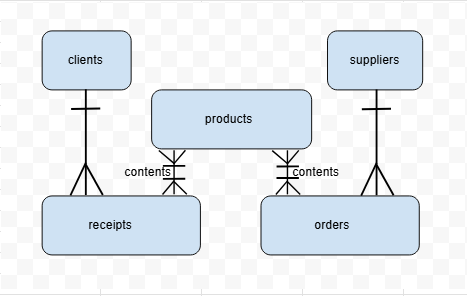

# Store Inventory & Sales Management Database

A relational SQLite database designed to manage retail store operations, including customer profiles, sales receipts, supplier information, supply orders, and automated inventory tracking.

## Features

* **Normalized Relational Schema:** Tracks clients, products, suppliers, customer receipts, and supply orders with proper primary keys, foreign keys, and data constraints.
* **Automated Inventory & Price Updates:** Uses SQLite triggers (`update_stock`, `update_stock_sold`, `update_purchase_price`) to automatically adjust product stock levels and purchase prices upon new orders or sales.
* **Query Optimization:** Includes indexes on frequently queried columns (`stock`, `name`, `date`, `status`) and a `receipt_cont` view for quick access to customer purchase histories.

## Entity Relationship Diagram



## Project Structure

* `schema.sql` — Database schema definition (`CREATE TABLE`, `CREATE INDEX`, `CREATE TRIGGER`, `CREATE VIEW`).
* `queries.sql` — Common SQL queries for reporting, analytics, and data manipulation.
* `DESIGN.md` — Comprehensive architectural documentation, design choices, and limitations.
* `diagram.png` — Visual Entity Relationship Diagram (Crow's Foot notation).
* `*.csv` — Sample datasets for populating the database tables.

## Getting Started

To create and populate the database locally using SQLite3:

```bash
sqlite3 store.db < schema.sql
```

Then import the sample CSV data inside the SQLite shell:

```sql
.mode csv
.import --skip 1 clients.csv clients
.import --skip 1 suppliers.csv suppliers
.import --skip 1 products.csv products
.import --skip 1 orders.csv orders
.import --skip 1 order_c.csv order_contents
.import --skip 1 receipts.csv receipts
.import --skip 1 receipt_c.csv receipt_contents
```
